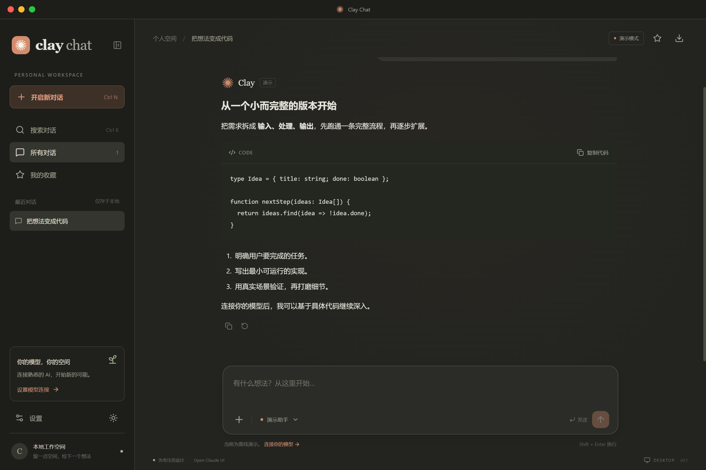
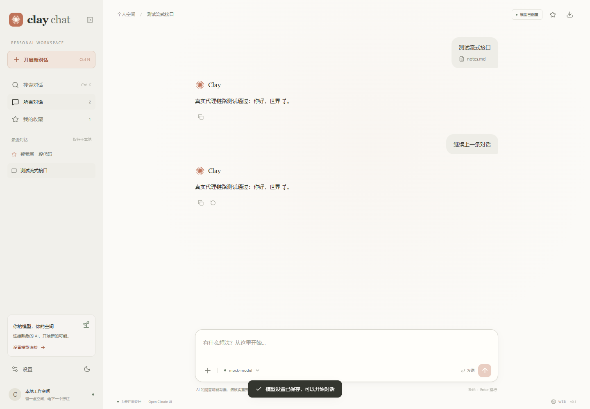
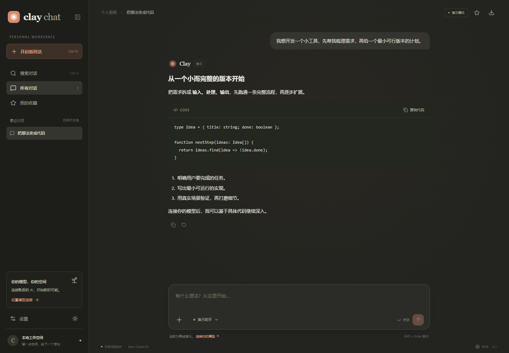
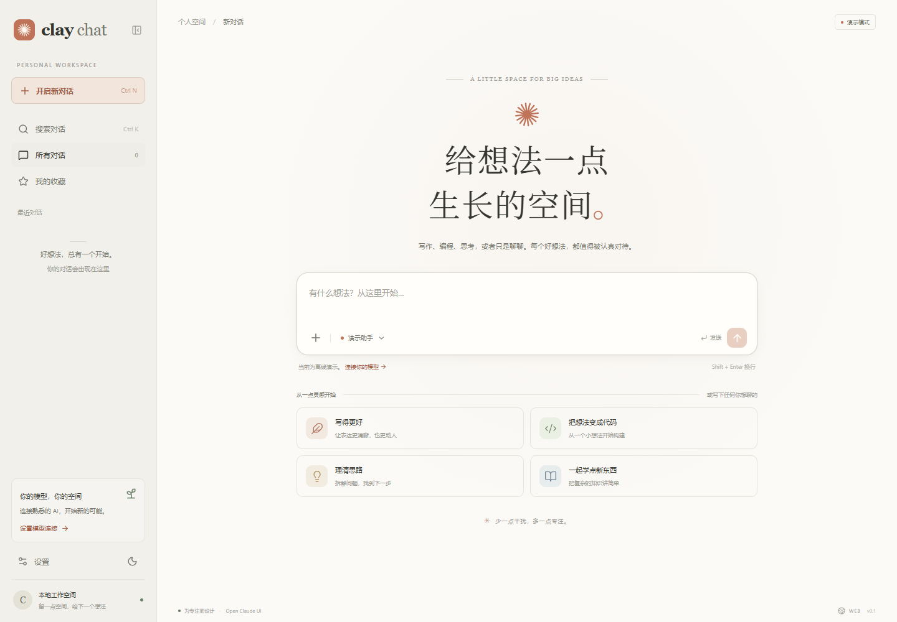
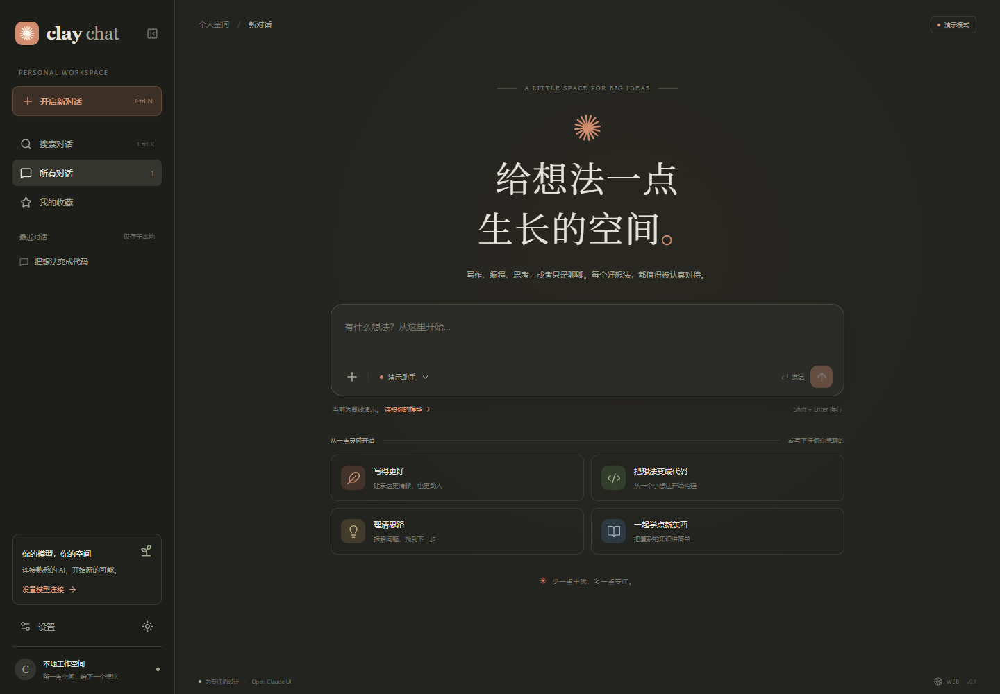
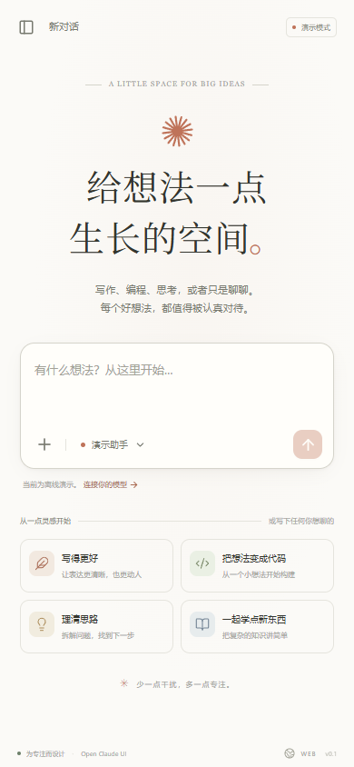
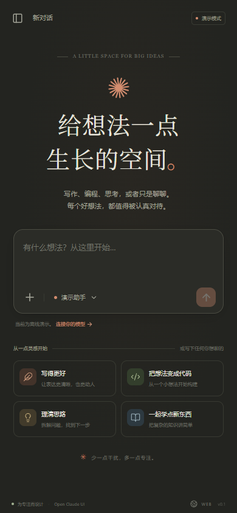
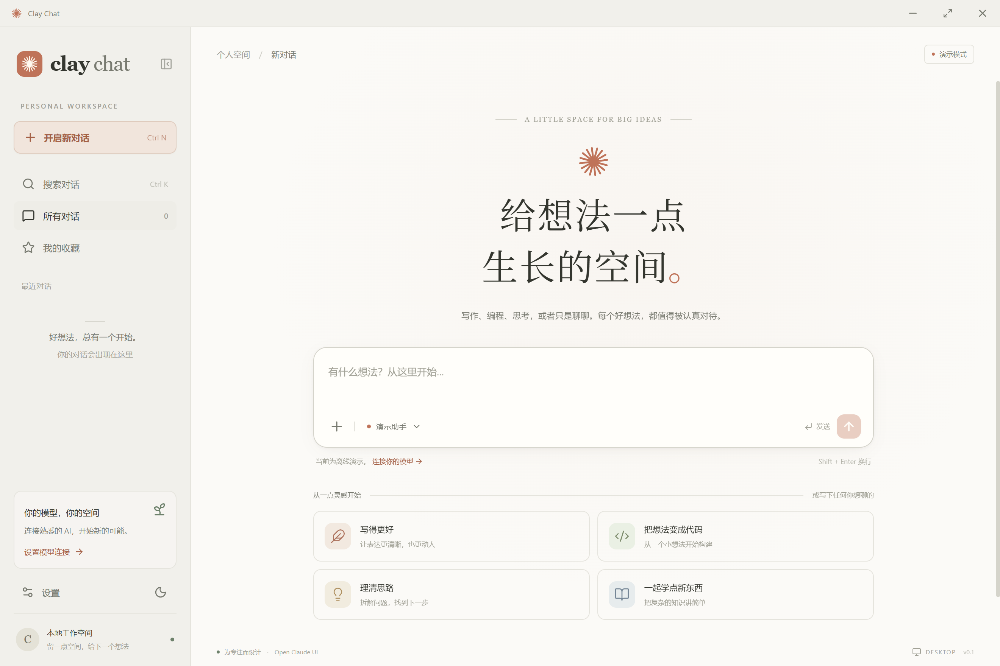
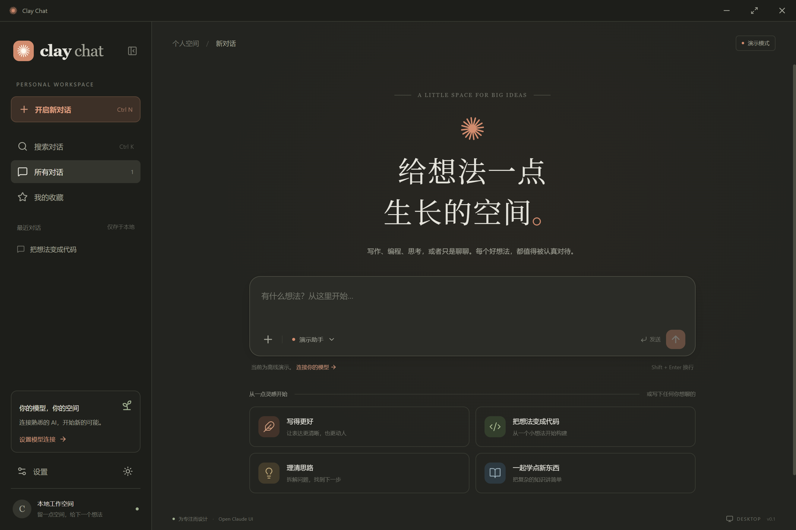

# Clay Chat

**中文** | [English](README.en.md) · **[github.com/dodoAling/clay-chat](https://github.com/dodoAling/clay-chat)**

[](https://github.com/dodoAling/clay-chat/stargazers)
[](https://github.com/dodoAling/clay-chat)
[](LICENSE)

把「Claude 桌面端」做成你能自己掌控的样子。Clay Chat 复用了 Claude 同款的 [Open Claude UI](https://github.com/Caho1/open-claude-ui) 界面、动效与手感，而模型、密钥和数据完全由你持有——接 OpenAI 兼容服务或 Claude API，对话全部留在本机。

它能做什么：

- **像在用 Claude 桌面端** —— 流式回复、Markdown 排版、代码块一键复制、随写随读的滚动锁定，第一眼就是熟悉的感觉。
- **自带 Key，不被订阅绑住** —— 任意 OpenAI 兼容的 `/chat/completions` 或 Anthropic `/messages`，云端服务、本地 Ollama 都接。
- **对话只存在你的设备上** —— 没有账号体系、没有云同步；桌面端 Key 进 Windows 凭据管理器，网页端 Key 只活在标签页里。
- **没有 Key 也能先玩** —— 内置明确标注的离线演示，开箱就能看到完整界面。
- **Windows 原生桌面端 + 网页版** —— Tauri 2 + Rust 单文件几 MB；同一套界面也能跑在浏览器里。

## 界面截图



| 浅色主题 | 深色主题 |
| --- | --- |
|  |  |
|  |  |
|  |  |
|  |  |

## 启动

需要 Node.js 22.12 或更新版本：

```sh
cd /path/to/clay-chat
npm ci
npm run dev
```

打开 http://127.0.0.1:5180。保持终端开启，按 Ctrl+C 停止。服务只监听回环地址；用 `PORT` 环境变量换端口。

网页版生产运行：`npm run build` 然后 `npm start`。`npm run package:web` 产出免安装网页包 `release/clay-chat-web/`（含 zip 归档）：只含 `dist/` 静态资源与 `web/` 服务端，有 Node.js 即可运行，不依赖 node_modules。当前是个人本地应用——公开为多用户网站前需要增加身份验证、服务端凭据管理与配额。

## 桌面应用

Windows 桌面版使用 Tauri 2 与 Rust 后端：模型请求经 reqwest 发出，通过 Tauri Channel 流式回传；对话持久化到应用数据目录；API Key 保存在操作系统凭据库。不捆绑 Node 或 Chromium，依赖系统 WebView2。

桌面开发需要 Rust 与 Windows 平台的 [Tauri 前置依赖](https://v2.tauri.app/start/prerequisites/)：

```powershell
npm run desktop:dev
```

Tauri 会启动网页开发服务并打开桌面窗口。如果 5180 已被另一份本项目开发服务占用，先停止它再启动。

构建独立桌面程序（内嵌网页资源与 Rust 后端）：

```powershell
npm run build:desktop
```

产物为 `desktop/src-tauri/target/release/clay-chat.exe`。`npm run package:desktop` 构建 Windows 安装包，NSIS 产物位于 `desktop/src-tauri/target/release/bundle/nsis/`。尚未配置代码签名与自动更新。

## 接入模型

打开 **设置**，选择一种连接方式：

- **演示助手** —— 离线预设回复，每条回答都有明确标注，不产生网络请求。
- **OpenAI 兼容** —— 任意暴露 `/chat/completions` 的服务，包括 Ollama 等本地服务；无需鉴权时 Key 可留空。
- **Claude API** —— Anthropic `/messages` 接口，携带 `anthropic-version: 2023-06-01`。

填入接口地址、模型 ID 与 API Key 后即可发送消息。接口地址可带 `/v1`，也接受完整端点路径。可选系统提示词随连接生效。

Clay Chat 是第三方客户端，与 Anthropic 无关联；相关名称与商标归各自所有者。

## 功能

- 流式回复，Markdown（GFM）渲染，代码一键复制，停止生成与重新生成。
- 本地会话：收藏、全文搜索、确认后删除、Markdown 导出。
- 文本与源码附件：每条最多 4 个、每个不超过 200 KB，内容随消息发送。暂不支持 PDF 解析、图像输入、工具执行或自动同步。
- 明暗主题、响应式布局、灵感卡片、提示条与收起侧边栏模式。
- Ctrl/Cmd+N 新对话，Ctrl/Cmd+K 搜索，Enter 发送，Shift+Enter 换行，带中文输入法保护。

## 数据与架构

```text
共享 React 界面
├── 网页：同源 Node 代理 → 模型服务
└── 桌面：Rust reqwest → 模型服务 → Tauri Channel
```

- 网页会话保存在浏览器 `localStorage`；Key 仅保存在当前标签页 `sessionStorage`。
- 桌面会话保存在应用数据目录（`app.claychat.desktop/workspace.json`，原子写入）；Key 使用系统凭据库，不进入会话文件、日志、导出或 Git。
- 网页服务仅监听回环地址，校验 Host/Origin，带内容安全策略、请求体积限制、上游错误脱敏与错误消息中的 Key 清洗。
- 原生命令只开放给本地 `main` 窗口，按 Tauri capabilities 限制；模型 Markdown 不允许执行 HTML。
- `CLAY_CHAT_DATA_DIR` 可指定隔离数据目录（并使用独立的凭据标识），主要用于测试。

## 目录

```text
src/                共享界面、会话逻辑、网页与原生传输适配
src/vendor/cds/     独立复制的 Open Claude UI 组件、主题、动效与滚动锁定
web/                网页同源服务及双协议代理
desktop/src-tauri/  Tauri 2、Rust 模型请求、本地数据与系统凭据
scripts/            网页和原生桌面验证
tests/              网页代理与 SSE 边界测试
docs/media/         README 截图
licenses/           上游许可证
```

运行不依赖相邻的 `open-claude-ui` 仓库。复制源为提交 `ddf3aea`，原始许可保留于 [licenses/open-claude-ui-LICENSE](licenses/open-claude-ui-LICENSE)。

## 验证

```powershell
npm run build
npm test
cargo test --manifest-path desktop/src-tauri/Cargo.toml
npm run test:ui
npm run test:desktop
```

原生验证需先构建桌面程序；可用 `CLAY_CHAT_DESKTOP_BINARY` 指定其他构建路径。测试使用本机模拟模型服务，不发送真实付费请求。发布前请用自己的模型服务检查可用性与兼容性。

## 联系

- 邮箱：[dodoaling@163.com](mailto:dodoaling@163.com)
- X (Twitter)：[@DodoAling](https://x.com/DodoAling)
- 微信：`dodoaling`
- 微信公众号：`DodoAling` —— 扫码关注，或按图中所示搜索：


## 许可

MIT —— 见 [LICENSE](LICENSE)。`src/vendor/cds/` 下的 vendored 组件仍遵循 [Open Claude UI 的 MIT 许可](licenses/open-claude-ui-LICENSE)。
